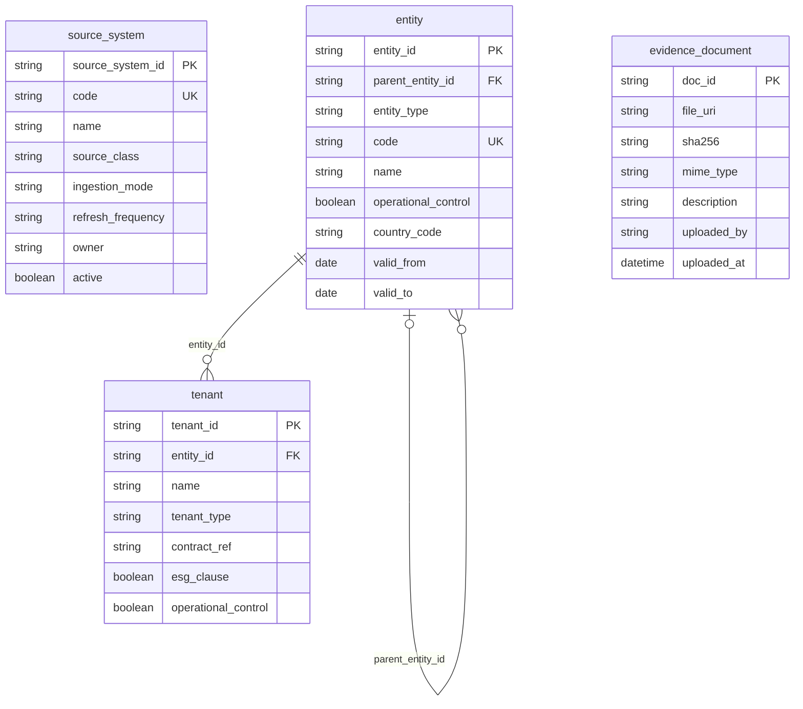
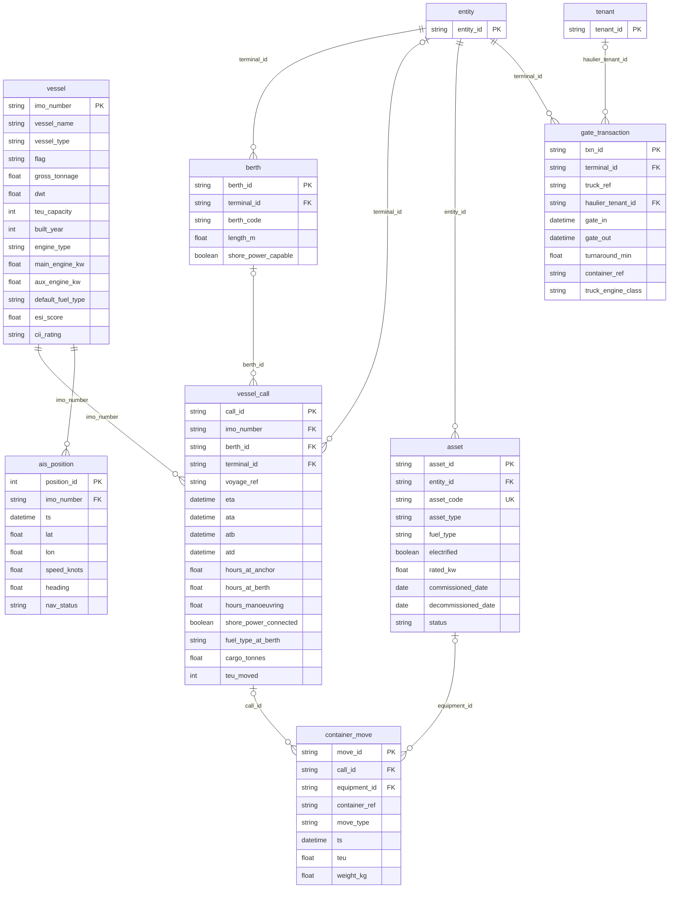
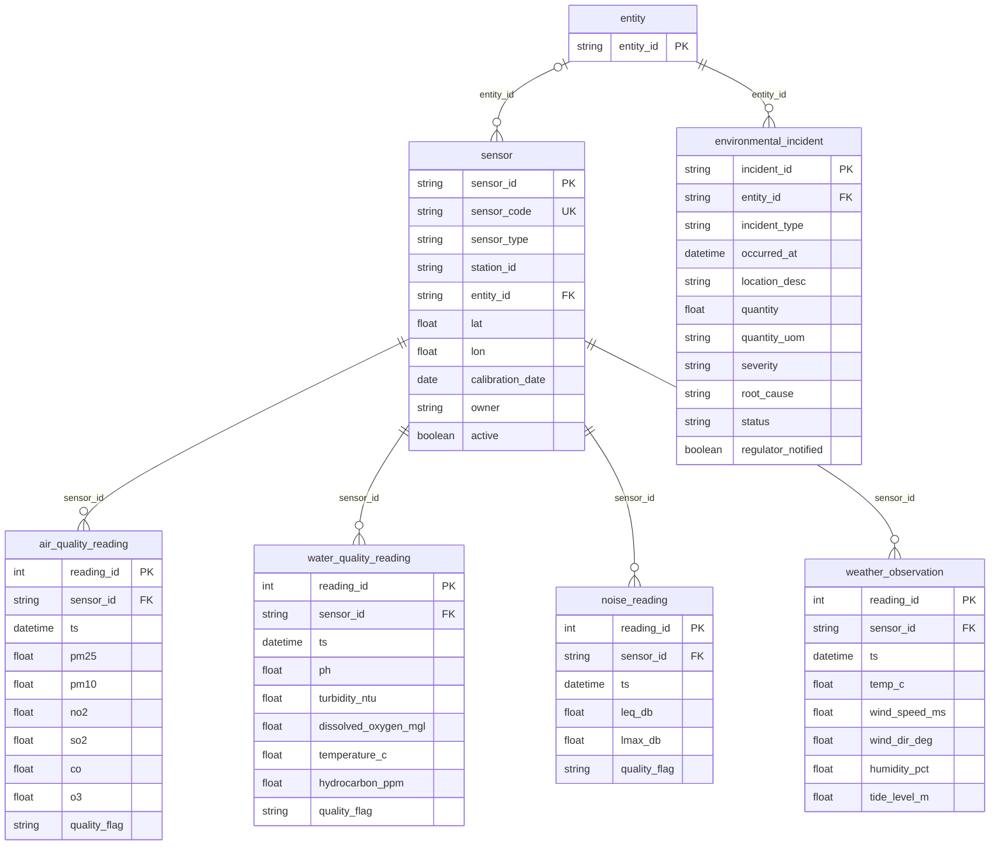
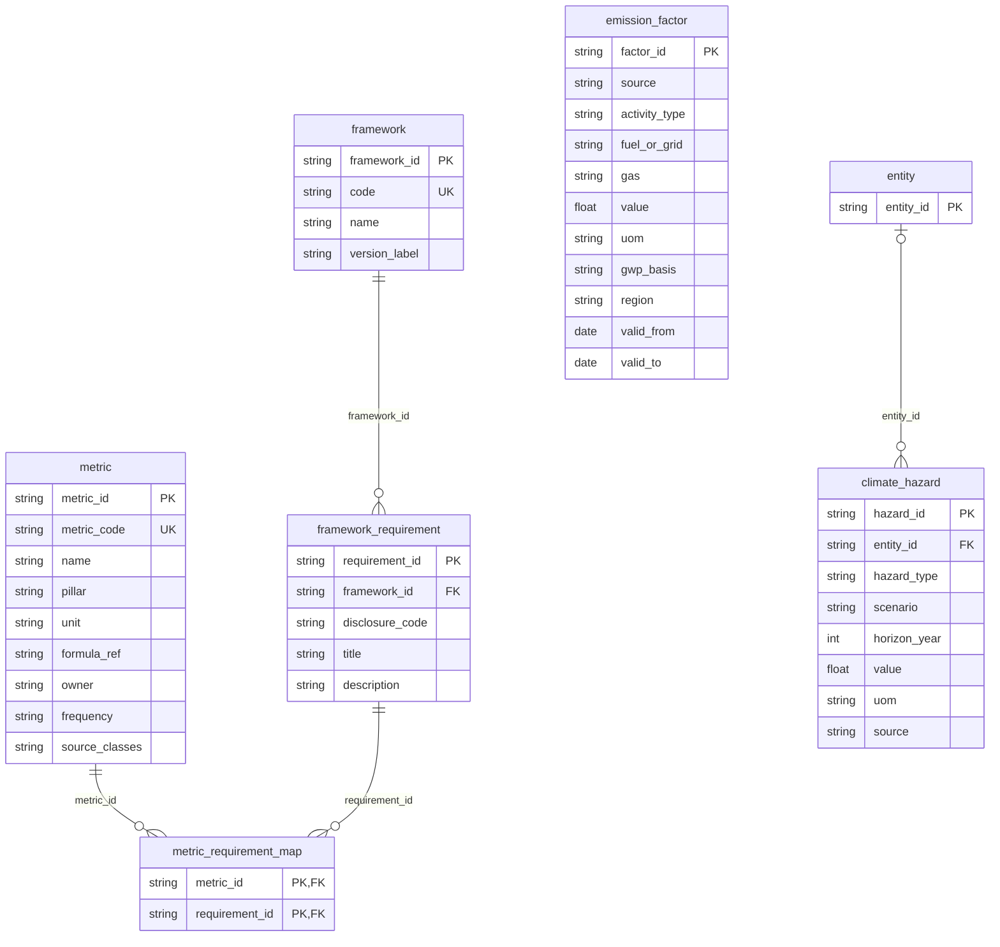
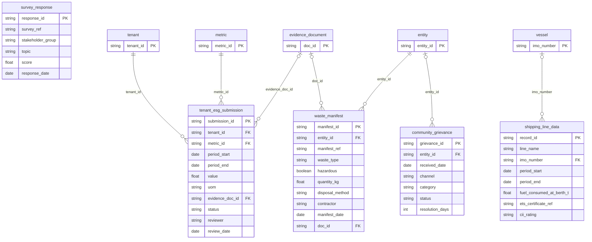
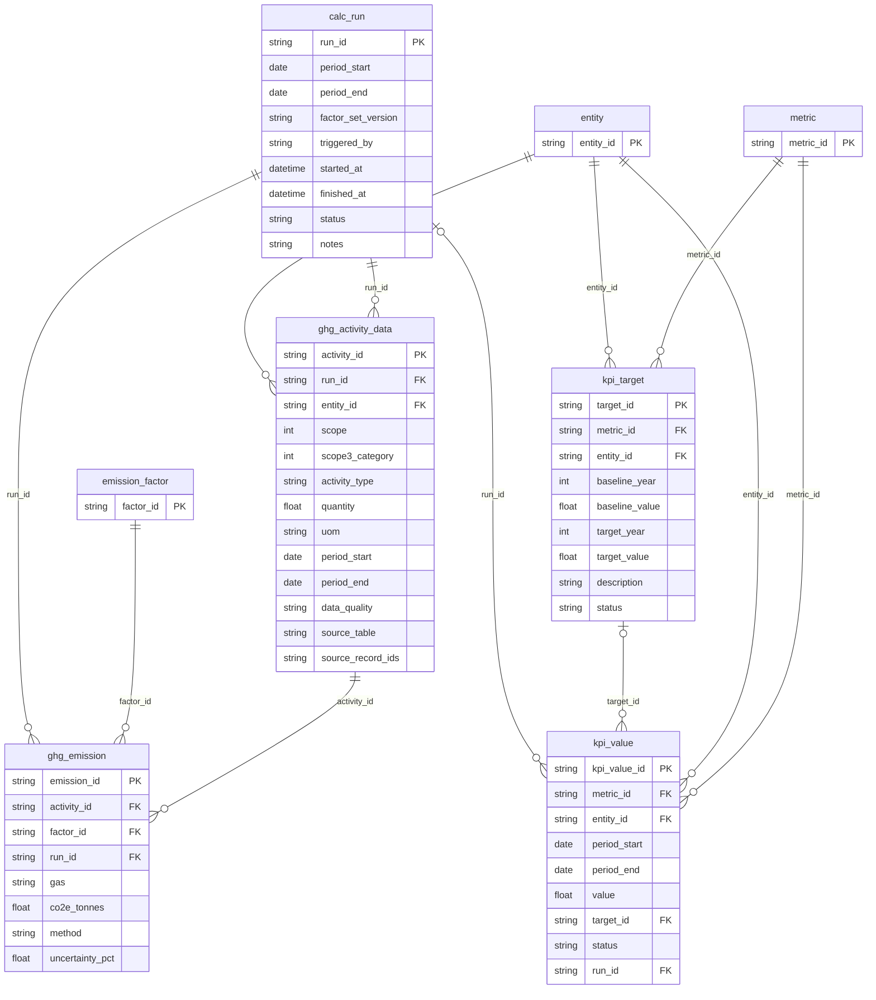

# Port ESG data model: entity relationship diagrams

49 tables, split into 8 domain diagrams plus a relationship overview. Generated from the same definition as `schema.sql` and the JSON Schemas.

Legend: `PK` primary key, `FK` foreign key, `UK` unique. A dotted-circle end (`|o`) means the foreign key is optional.

Every fact table in classes A, D, E and G also carries the common metadata columns (`source_system_id`, `source_record_id`, `ingested_at`, `data_quality`, `validation_status`, `version`, `created_by`, `approved_by`). To keep the diagrams readable they are omitted here (including the link to `source_system`); see `schema.sql` for the full definitions.

## Overview (relationships only)

```mermaid
erDiagram
    entity |o--o{ entity : "parent_entity_id"
    entity ||--o{ tenant : "entity_id"
    entity ||--o{ berth : "terminal_id"
    vessel ||--o{ vessel_call : "imo_number"
    berth |o--o{ vessel_call : "berth_id"
    entity |o--o{ vessel_call : "terminal_id"
    entity ||--o{ asset : "entity_id"
    vessel ||--o{ ais_position : "imo_number"
    vessel_call |o--o{ container_move : "call_id"
    asset |o--o{ container_move : "equipment_id"
    entity ||--o{ gate_transaction : "terminal_id"
    tenant |o--o{ gate_transaction : "haulier_tenant_id"
    entity ||--o{ meter : "entity_id"
    asset |o--o{ meter : "asset_id"
    tenant |o--o{ meter : "tenant_id"
    meter ||--o{ meter_register_reading : "meter_id"
    evidence_document |o--o{ meter_register_reading : "evidence_doc_id"
    meter ||--o{ energy_meter_reading : "meter_id"
    asset |o--o{ fuel_transaction : "asset_id"
    entity ||--o{ fuel_transaction : "entity_id"
    vessel_call ||--o{ shore_power_session : "call_id"
    berth |o--o{ shore_power_session : "berth_id"
    asset |o--o{ refrigerant_event : "asset_id"
    entity |o--o{ sensor : "entity_id"
    sensor ||--o{ air_quality_reading : "sensor_id"
    sensor ||--o{ water_quality_reading : "sensor_id"
    sensor ||--o{ noise_reading : "sensor_id"
    sensor ||--o{ weather_observation : "sensor_id"
    entity ||--o{ environmental_incident : "entity_id"
    entity |o--o{ spend_record : "entity_id"
    entity ||--o{ utility_invoice : "entity_id"
    entity ||--o{ employee_snapshot : "entity_id"
    entity ||--o{ training_record : "entity_id"
    entity ||--o{ hours_worked : "entity_id"
    entity ||--o{ safety_incident : "entity_id"
    entity |o--o{ risk : "entity_id"
    evidence_document |o--o{ policy : "doc_id"
    entity |o--o{ audit_finding : "entity_id"
    evidence_document |o--o{ audit_finding : "doc_id"
    entity ||--o{ certification : "entity_id"
    evidence_document |o--o{ certification : "doc_id"
    framework ||--o{ framework_requirement : "framework_id"
    metric ||--o{ metric_requirement_map : "metric_id"
    framework_requirement ||--o{ metric_requirement_map : "requirement_id"
    entity |o--o{ climate_hazard : "entity_id"
    tenant ||--o{ tenant_esg_submission : "tenant_id"
    metric ||--o{ tenant_esg_submission : "metric_id"
    evidence_document |o--o{ tenant_esg_submission : "evidence_doc_id"
    vessel |o--o{ shipping_line_data : "imo_number"
    entity ||--o{ waste_manifest : "entity_id"
    evidence_document |o--o{ waste_manifest : "doc_id"
    entity |o--o{ community_grievance : "entity_id"
    metric ||--o{ kpi_target : "metric_id"
    entity ||--o{ kpi_target : "entity_id"
    calc_run ||--o{ ghg_activity_data : "run_id"
    entity ||--o{ ghg_activity_data : "entity_id"
    ghg_activity_data ||--o{ ghg_emission : "activity_id"
    emission_factor ||--o{ ghg_emission : "factor_id"
    calc_run ||--o{ ghg_emission : "run_id"
    metric ||--o{ kpi_value : "metric_id"
    entity ||--o{ kpi_value : "entity_id"
    kpi_target |o--o{ kpi_value : "target_id"
    calc_run |o--o{ kpi_value : "run_id"
```

## Core: source registry, organisation, tenants, evidence

## A. Port operations: vessels, calls, cargo, gate

## B. Energy and utilities

```mermaid
erDiagram
    meter {
        string meter_id PK
        string meter_code UK
        string entity_id FK
        string asset_id FK
        string tenant_id FK
        string meter_type
        string location_desc
        string scope_boundary
        string uom
        string energy_type
        float multiplier
        int register_digits
    }
    meter_register_reading {
        string register_reading_id PK
        string meter_id FK
        datetime read_at
        float register_value
        string uom
        string evidence_doc_id FK
        boolean rollover
        float consumption_raw
        int derived_reading_id
        string note
    }
    energy_meter_reading {
        int reading_id PK
        string meter_id FK
        datetime ts
        float energy_kwh
        string energy_type
    }
    fuel_transaction {
        string txn_id PK
        string asset_id FK
        string entity_id FK
        string fuel_type
        float litres
        datetime ts
        string dispensing_point
        float cost
        string currency
    }
    shore_power_session {
        string session_id PK
        string call_id FK
        string berth_id FK
        datetime start_ts
        datetime end_ts
        float kwh_delivered
        float peak_kw
    }
    refrigerant_event {
        string event_id PK
        string asset_id FK
        string work_order_ref
        string refrigerant_type
        float kg_added
        date event_date
    }
    entity {
        string entity_id PK
    }
    asset {
        string asset_id PK
    }
    tenant {
        string tenant_id PK
    }
    evidence_document {
        string doc_id PK
    }
    vessel_call {
        string call_id PK
    }
    berth {
        string berth_id PK
    }
    entity ||--o{ meter : "entity_id"
    asset |o--o{ meter : "asset_id"
    tenant |o--o{ meter : "tenant_id"
    meter ||--o{ meter_register_reading : "meter_id"
    evidence_document |o--o{ meter_register_reading : "evidence_doc_id"
    meter ||--o{ energy_meter_reading : "meter_id"
    asset |o--o{ fuel_transaction : "asset_id"
    entity ||--o{ fuel_transaction : "entity_id"
    vessel_call ||--o{ shore_power_session : "call_id"
    berth |o--o{ shore_power_session : "berth_id"
    asset |o--o{ refrigerant_event : "asset_id"
```

## C. Environmental monitoring

## D. Enterprise systems: HR, HSE, ERP, GRC

```mermaid
erDiagram
    spend_record {
        string spend_id PK
        string entity_id FK
        string po_ref
        string supplier_ref
        string supplier_name
        string category
        string material_code
        float quantity
        string uom
        float amount
        string currency
        date spend_date
        int scope3_category
    }
    utility_invoice {
        string invoice_id PK
        string entity_id FK
        string utility_type
        float consumption
        string uom
        date period_start
        date period_end
        float amount
        string currency
    }
    employee_snapshot {
        string snapshot_id PK
        string entity_id FK
        date period_end
        string department
        string gender
        string nationality_group
        string age_band
        string grade_band
        string contract_type
        int headcount
        int leavers
        int voluntary_leavers
    }
    training_record {
        string training_id PK
        string entity_id FK
        date period_start
        date period_end
        string course_category
        float training_hours
        int participants
    }
    hours_worked {
        string hours_id PK
        string entity_id FK
        date period_start
        date period_end
        float employee_hours
        float contractor_hours
    }
    safety_incident {
        string incident_id PK
        string entity_id FK
        string incident_type
        string person_type
        datetime occurred_at
        int lost_days
        string severity
        string injury_class
        string location_desc
        string root_cause
        string status
    }
    risk {
        string risk_id PK
        string risk_code UK
        string entity_id FK
        string category
        string title
        int likelihood
        int impact
        string owner
        string mitigation
        string status
    }
    policy {
        string policy_id PK
        string title
        string version_label
        date approval_date
        date next_review_date
        string owner_role
        string doc_id FK
    }
    audit_finding {
        string finding_id PK
        string entity_id FK
        string audit_ref
        string severity
        string description
        date due_date
        string status
        string doc_id FK
    }
    certification {
        string certification_id PK
        string entity_id FK
        string standard
        date issue_date
        date expiry_date
        string result
        string doc_id FK
    }
    entity {
        string entity_id PK
    }
    evidence_document {
        string doc_id PK
    }
    entity |o--o{ spend_record : "entity_id"
    entity ||--o{ utility_invoice : "entity_id"
    entity ||--o{ employee_snapshot : "entity_id"
    entity ||--o{ training_record : "entity_id"
    entity ||--o{ hours_worked : "entity_id"
    entity ||--o{ safety_incident : "entity_id"
    entity |o--o{ risk : "entity_id"
    evidence_document |o--o{ policy : "doc_id"
    entity |o--o{ audit_finding : "entity_id"
    evidence_document |o--o{ audit_finding : "doc_id"
    entity ||--o{ certification : "entity_id"
    evidence_document |o--o{ certification : "doc_id"
```

## F. Reference: frameworks, metrics, emission factors

## E and G. Third-party submissions and manual records

## H. Derived: GHG inventory and KPIs

